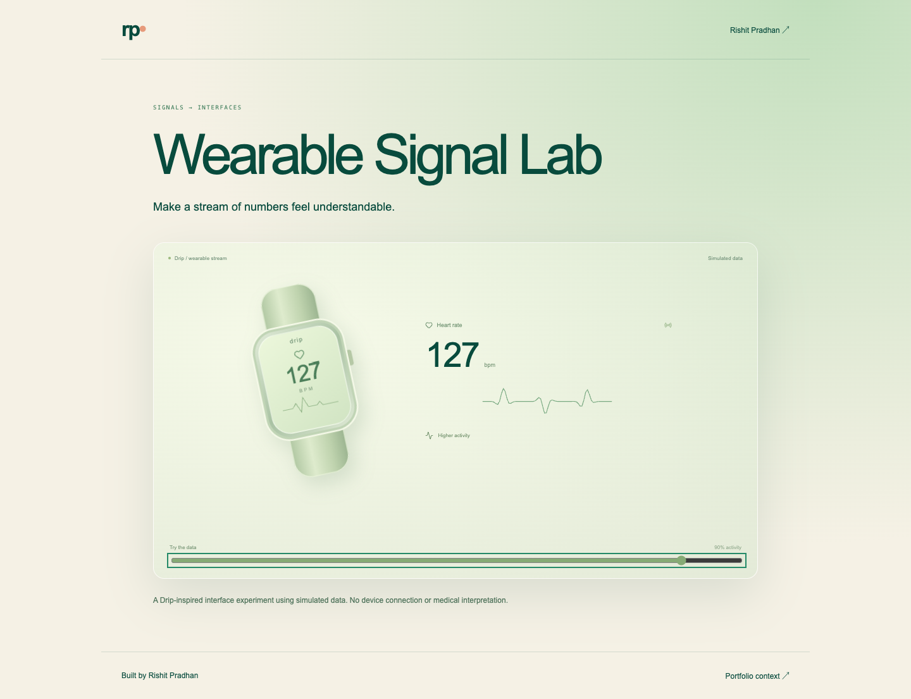

# Wearable Signal Lab

**[Download & run locally](LOCAL.md)** — a short guide and ready-to-run ZIP.

An interactive interface study for making a wearable signal understandable. Change simulated activity and watch the sample heart-rate readout, trace, and interface respond.

[Live portfolio preview](https://rishitpradhan.com/projects/drip/) · [Rishit Pradhan](https://rishitpradhan.com)



## What works

- Activity-controlled sample signal and animated SVG waveform.
- A watch visualization, contextual activity labels, and a visible simulated-data label.
- Reduced-motion support and paused/hidden-tab behavior.
- A small pure signal module that is independent of the React presentation.

## Run locally

Requires Node.js 22.17+ and npm.

```sh
npm ci
npm run dev
```

Open the localhost URL printed by Vite.

```sh
npm test
npm run build
npm run preview
```

The build is static and outputs to `dist/`. No API key, account, or server is required. The live link above opens this experiment inside the personal portfolio; this repo runs it independently. For World Garden and Wearable Signal Lab, choose the interactive preview tab in the portfolio.

## How it is built

`src/signal.ts` generates deterministic illustrative values and SVG paths. `src/WearablePreview.tsx` renders the interface. `src/useReducedMotion.ts` follows the browser preference.

See [implementation notes](docs/architecture.md) for the model, constraints, and tradeoffs.

## Verification

Malformed-input handling, activity response, motion-disabled stability, and finite evolving SVG output. Run the Node test suite with `npm test`; `npm run build` also type-checks the React/TypeScript app.

## Scope

A Drip-inspired UI experiment using fabricated sample data. It does not connect to a wearable, infer a person’s health, validate a physiological model, or provide medical advice. The Drip product source is separate.

## Origin and license

Extracted and developed as a standalone experiment from [Rishit’s portfolio](https://rishitpradhan.com). React, TypeScript, Vite, and Lucide icons. Source code is MIT licensed; dependency licenses remain their own.
